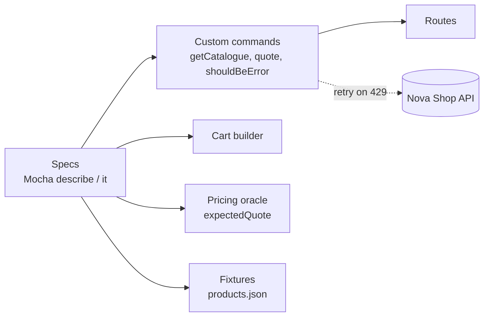

<div align="center">

# 🛒 Cypress + Mocha API Framework

**API tests for the Nova Shop pricing API, with a pricing oracle and rate-limit handling**

   

[](https://github.com/skamirullah/practiceqa-cypress-mocha-api/actions/workflows/ci.yml)  

[What it tests](#-what-it-tests) · [Quick start](#-quick-start) · [How it is built](#-how-it-is-built) · [Structure](#-project-structure) · [Reports](#-reports-and-debugging)

</div>

---

## 👋 Overview

An API automation framework that uses Cypress as an HTTP client and test runner. It tests the catalogue and the quote endpoint that prices a shopping cart, including coupons, shipping, tax and every way a request can be refused.

|  |  |
|---|---|
| **App under test** | [Nova Shop API](https://www.practiceqaautomation.com/api-practice): the catalogue and the cart quote |
| **Kind of testing** | API |
| **Tests** | 20 tests |
| **Runs in** | Headless Cypress; no browser pages are opened |

### Highlights

- **A pricing oracle.** Expected totals are calculated from the rules the API publishes.
- **Custom commands.** `cy.quote(cart)` and `cy.getCatalogue()` hide URLs and options.
- **Rate-limit aware.** A 429 is retried after a pause, so the suite slows down instead of failing.
- **Builder for requests.** `aCart().add('p1', 2).coupon('SAVE10').build()`.

## 🎯 What it tests

| Area | What is checked |
|---|---|
| Catalogue | Status and content type, required fields on every product, unique ids, published pricing rules |
| Pricing | Single item, several lines, line totals and item count |
| Shipping | Charged on small orders, free above the threshold, express always charged |
| Coupons | `SAVE10` and `FLAT20` checked against the oracle; codes accepted in any case |
| 400 | Empty cart, unknown shipping method, invalid quantity |
| 404 / 409 / 413 | Unknown product, sold out, over stock, too many lines |
| 422 | Unknown coupon, coupon below its minimum order |

## 🚀 Quick start

**You need:** Node.js 20+.

```bash
git clone https://github.com/skamirullah/practiceqa-cypress-mocha-api.git
cd practiceqa-cypress-mocha-api
npm install
```

| Command | What it does |
|---|---|
| `npm test` | Run every spec |
| `npm run test:smoke` | Run only tests tagged `@smoke` |
| `npm run open` | Open the Cypress app to watch requests |
| `npm run lint` | Check the code with ESLint |

> The quote API allows 30 requests a minute. The suite uses about 20 per run and backs off automatically if the limit is reached.

## 🧱 How it is built



- **Commands as the client layer.** Specs never call `cy.request` directly.
- **Oracle from published rules.** The catalogue returns prices, shipping costs and the tax rate; `expectedQuote()` applies them.
- **`failOnStatusCode: false` in one place.** Negative tests can assert on 4xx responses through `shouldBeError(status, text)`.
- **Data-driven coupons.** One test body runs for each coupon.
- **Routes in one file.** A path change is a one-line fix.

## 📁 Project structure

```text
cypress
├── e2e/api
│   ├── catalogue.cy.js             # GET /api/shop/products
│   ├── quote.cy.js                 # pricing, shipping, coupons
│   └── quote.validation.cy.js      # every 4xx
├── support
│   ├── commands.js                 # getCatalogue, quote (with back-off), shouldBeError
│   ├── routes.js
│   └── e2e.js
├── utils
│   ├── cartBuilder.js              # builds quote requests
│   └── pricing.js                  # test oracle
└── fixtures/products.json
cypress.config.js
```

## ⚙️ Configuration

Settings live in `cypress.config.js`. Any of them can be overridden from the command line or with `CYPRESS_` environment variables.

| Setting | Default | What it does |
|---|---|---|
| `baseUrl` | the live site | API host. Override with `CYPRESS_BASE_URL`. |
| `retries.runMode` | `1` | Retries for a failed test in headless runs. |
| `grepTags` | none | Run only tests with a tag, for example `@smoke`. |

## 📊 Reports and debugging

- **Mochawesome**: `reports/index.html`, one self-contained file with charts.
- **`npm run open`** shows each request and response in the Cypress command log.

## 🔁 Continuous integration

[GitHub Actions](.github/workflows/ci.yml) lints and runs the specs on every push and pull request and uploads the HTML report.

## 🧪 About the app under test

The Nova Shop API serves the same catalogue and pricing rules as the Nova Shop store, and prices a cart with the same maths as the UI. It is stateless, so nothing a test sends is stored.

[PracticeQAAutomation](https://www.practiceqaautomation.com) is a free practice site for QA engineers, with realistic apps to automate with Selenium, Playwright and Cypress. All data in these tests is fictional.

## 👤 Author

**Sk Amir Ullah** · Technical Lead, SDET and Test Automation

[Portfolio](https://skamirullah.com) · [LinkedIn](https://linkedin.com/in/skamirullah) · [GitHub](https://github.com/skamirullah) · [PracticeQAAutomation](https://www.practiceqaautomation.com)

## 📄 License

[MIT](LICENSE)
